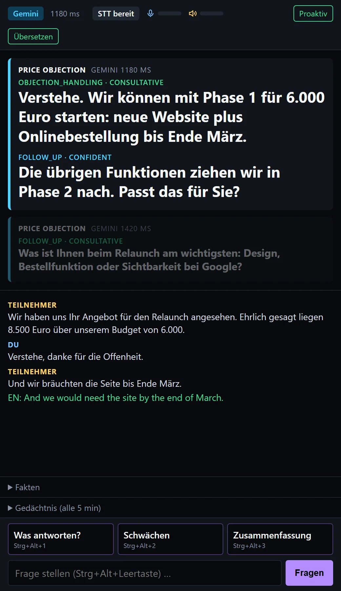

# Meeting Copilot

A local, real-time AI meeting assistant for Windows. It captures your microphone and the meeting audio itself, transcribes both on your GPU, and shows short, read-aloud-ready reply suggestions in a high-contrast window next to your video call. It works with Teams, Zoom, Meet, phone apps or anything else that plays sound.

- **[User]**: your microphone
- **[Participant]**: everything your PC plays (WASAPI loopback), i.e. the other people in the call

<p align="center"></p>

Speech recognition, the knowledge base and the fallback LLM all run locally. Only the prompts sent to Gemini (if configured) leave your machine.

## Features

- **Dual-stream capture** (mic + WASAPI loopback), Silero VAD, 1.5-2.5 s speech chunks
- **faster-whisper `large-v3-turbo` on CUDA**: about 360 ms per chunk on an RTX 4060, German/English
- **Proactive suggestions** for questions, objections and action items (1-2 sentences, ready to say)
- **Push-to-ask**: preset buttons, global hotkeys, or a typed question ("What should I answer?")
- **Live translation** German to English and English to German
- **Knowledge base (RAG)** over your own Markdown/JSON notes, plus keyword flashcards
- **Facts sheet** (budgets, names, dates) extracted automatically and kept across meetings
- **Meeting memory**: a rolling summary every 5 minutes, so the AI remembers the whole meeting and not just the last few sentences
- **Gemini Flash** as the primary engine, with **local Ollama** racing in after 2.5 s or taking over when offline or out of quota
- Two roles: client/sales calls (`PROMPT=system`) or job interviews and meetings at work (`PROMPT=interview`)

## Requirements

- Windows 10/11, NVIDIA GPU (tested on an RTX 4060 Laptop, 8 GB)
- [uv](https://docs.astral.sh/uv/) (installs Python 3.12 and all dependencies, including the CUDA libraries)
- [Ollama](https://ollama.com) with `granite4:7b-a1b-h` (the offline fallback):
  ```sh
  ollama pull granite4:7b-a1b-h
  ```
- A Gemini API key (optional; without it everything runs on Ollama). The free tier allows only about 20 requests per day per model, which a single meeting exceeds, so enable billing for real use.
- Chrome, Edge or Brave for the app window (otherwise the default browser opens)
- **Headphones recommended.** With speakers the mic picks up the participants. The app suppresses obvious echoes, but headphones are cleaner.

## Setup

```sh
git clone https://github.com/masrisystems/meeting-copilot.git
cd meeting-copilot
uv sync
cp .env.example .env                 # add GEMINI_API_KEY, pick PROMPT, add KB_EXTRA_PATHS
uv run python -m copilot.rag index   # build the knowledge base index
```

The first run downloads the Whisper model (`large-v3-turbo`, about 1.6 GB) and the German embedding model.

### Your own knowledge

The bundled `examples/` (a sample agency FAQ, a sales playbook and flashcards) are used until you add your own:

| Path | Content | Git |
| --- | --- | --- |
| `knowledge_base/` | Your `.md` / `.json` notes (searched semantically, top 3 per prompt) | ignored |
| `knowledge_base.json` | Keyword flashcards, injected when the keyword is spoken | ignored |
| `KB_EXTRA_PATHS` in `.env` | Any other files or folders, e.g. interview prep in your notes vault | — |
| `facts.json` | Facts collected during meetings | ignored |

Re-run `uv run python -m copilot.rag index` after changing them, or keep `index --watch` running.

Example for a job interview:
```ini
PROMPT=interview
KB_EXTRA_PATHS=C:/Users/me/Notes/Interview Prep.md;C:/Users/me/Notes/CV.md
```

## Run

```sh
uv run python -m copilot
```

This opens a chromeless window at `http://127.0.0.1:8765`. Keep it on top with a tool such as WindowTop (a built-in overlay is on the [roadmap](tickets/README.md)). Options:

| Flag | Effect |
| --- | --- |
| `--fresh-facts` | Start the meeting with an empty facts sheet (overwrites `facts.json` on the first new fact) |
| `--no-browser` | Don't open the window (open the URL yourself) |
| `--no-hotkeys` | Don't register global hotkeys |

### Buttons and hotkeys

| Keys | Action |
| --- | --- |
| `Ctrl+Alt+1` | "Was soll ich jetzt antworten?" (also a button) |
| `Ctrl+Alt+2` | "Zeig die Schwächen in ihrem Angebot bzw. Argument auf." (also a button) |
| `Ctrl+Alt+3` | "Fasse die letzten Minuten in 2 Sätzen zusammen." (also a button) |
| `Ctrl+Alt+Space` | Focus the question box to type your own question |
| `Ctrl+Alt+T` | Toggle live translation |
| `Ctrl+Alt+P` | Pause/resume proactive suggestions |

Presets (label, question, hotkey) are defined once in `PRESETS` in `copilot/config.py`.

## How it works

```
mic ──────┐                                                                   ┌─ proactive suggestions
          ├─ Silero VAD ─ 1.5–2.5 s chunks ─ faster-whisper ─ transcript ─┼─ push-to-ask answers
loopback ─┘   (per source)                      (CUDA)       (turns)      └─ translations
                                                                  │
                facts.json + meeting memory (5 min) + knowledge base (RAG) + last 15 turns
                                                                  │
                                 Gemini Flash ──(> 2.5 s: race)── Ollama
```

- **Chunking:** a chunk ends at a pause once it is at least 1.5 s long, and is force-cut at 2.5 s at the quietest point. Short replies ("Ja.") are still sent once the speaker stops.
- **Transcription:** the language (German/English) is detected per speaker and re-checked every few chunks. Detecting on every chunk would add about 240 ms.
- **Proactive mode** reacts only to participant speech. It shows at most 2 suggestions, and stays quiet when the model reports `trigger: None`. Your own speech goes into the context but never triggers a suggestion.
- **Facts:** the model returns `new_facts`. They are merged into `facts.json`, with lists combined rather than overwritten.
- **Memory:** every `MEMORY_INTERVAL` seconds (default 300), the new part of the transcript is folded into a running summary covering the discussion, decisions, open points and mood. It is sent as `[MEMORY]` with every prompt, shown under "Gedächtnis" in the window, and saved as `sessions/<timestamp>.memory.md`.
- **Failover:** if Gemini hasn't answered within 2.5 s, Ollama starts in parallel and the first finished answer wins. If Gemini errors, the request goes to Ollama straight away. On repeated errors Gemini pauses for 60 s; on a quota error (429) it pauses for as long as Google says. The header shows which engine answered and why Gemini is off.
- **Session log:** every transcript segment is appended to `sessions/<timestamp>.jsonl`.

The prompts are in `copilot/prompts/` (`system.md` for client calls, `interview.md` for interviews).

## Tools

```sh
uv run python -m copilot.devices                   # list audio devices, live level meters
uv run python -m copilot.stt_bench recording.wav   # VAD chunks + Whisper latency on a WAV file
uv run python -m copilot.rag search "Was kostet eine Website?"
uv run python -m copilot.rag index --watch         # re-index when knowledge files change
uv run pytest                                      # unit tests (no audio/GPU needed)
```

To use a device other than the Windows default, set `MIC_DEVICE` / `LOOPBACK_DEVICE` in `.env` to part of its name, as shown by `copilot.devices`.

## Consent and privacy

This tool transcribes other people's speech. Recording or transcribing a conversation without the participants' consent may be illegal where you live (in Germany, for example, §201 StGB). Tell participants and get their consent. Transcripts, memory and facts are stored locally in `sessions/` and `facts.json`. With Gemini enabled, transcript excerpts are sent to Google.

## Roadmap

See [tickets/README.md](tickets/README.md): built-in overlay window, settings UI, streaming suggestions, echo cancellation, speaker diarization, quota control, meeting summaries and export, meeting profiles, and a Windows installer.

## License

[MIT](LICENSE) © Mohamad Masri, [Masri Systems](https://masrisystems.com)
